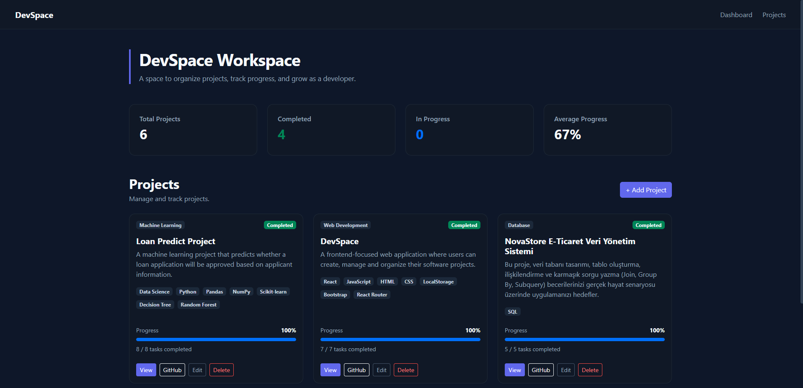

# DevSpace

A frontend project management dashboard built with React and LocalStorage.

Live demo: https://devspaceprojectmanagementdashboard.netlify.app

## Screenshots



## Features

- Project management
- Add, edit and delete projects
- Project task management
- Automatic progress calculation
- Project status tracking
- GitHub project links
- Search projects
- Card and list views
- LocalStorage data management
- Responsive design
- Dark theme

## Technologies

- React
- JavaScript
- Bootstrap
- CSS
- LocalStorage
- React Router
- Vite

## Installation

```bash
npm install
```

## Run

```bash
npm run dev
```

## Data Storage

All data is stored in the browser's LocalStorage. No backend or database is used.